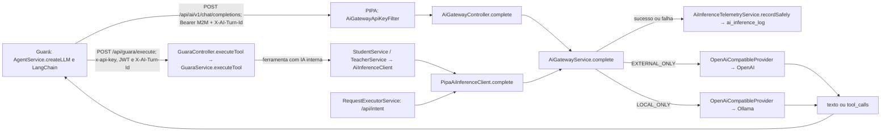

# PIPA - Plataforma integrada personalizável para assistentes

**PIPA** é uma plataforma digital desenvolvida com **Spring Boot**
que fornece um meio pelo qual instituições parceiras pode integrar os seus sistemas
académicos ou bases de dados por meio de provedores com assistentes digitais.
---

## Arquitetura do Sistema
- Cada projeto/módulo da PIPA possui responsabilidade bem definida e tecnologias específicas

### Visão Geral dos Módulos

| Projeto           | Responsabilidade                                           |
|-------------------|------------------------------------------------------------|
| `API_AI`          | Módulo JAR de comunicação com a OpenAI via Spring AI       |
| `AUTH_SERVER`     | Servidor de autorização e emissão de JWT                   |
| `PIPA`            | Núcleo de domínio e orquestração das intenções do usuário  |
| `PIPA_MIDDLEWARE` | Configuração de filtros JWT                                |
| `PIPA_INTEGRATOR` | Contratos e interfaces para provedores                     |
| `UEG_PROVIDER`    | Provedor de serviços reais usados no estudo de caso da UEG |
| `PIPA_EMAIL`      | Envio de emails                                            |


---

## Detalhamento dos Projetos

### API_AI

Módulo JAR responsável pela comunicação entre a plataforma e a **OpenAI**, permitindo integração com modelos de linguagem como o ChatGPT. Embora possua dependências Spring Web e WebFlux, o código atual não contém controller nem endpoint REST; suas classes são consumidas diretamente pelos demais módulos Java.

**Tecnologias utilizadas:**
- `spring-ai-starter-model-openai:1.0.0-SNAPSHOT`
- `spring-ai-bom:1.0.0-SNAPSHOT`
- `jackson-databind`

---

### AUTH_SERVER

Servidor de autorização central, encarregado da autenticação dos usuários e emissão de **tokens JWT**.

**Tecnologias utilizadas:**
- `spring-boot-starter-thymeleaf`
- `spring-boot-starter-validation`
- `io.jsonwebtoken:jjwt-api`, `jjwt-impl`, `jjwt-jackson` (`0.12.5`)

---

### PIPA

Responsável pelo **domínio do sistema** e pela orquestração dos módulos da plataforma. O fluxo standalone em `/api/intent` processa a intenção com `RequestExecutorService` e `AiInferenceClient`. Na integração com o Guará, o PIPA descobre e executa ferramentas de forma determinística pelos endpoints `/api/guara/**`; a seleção conversacional da ferramenta permanece no LangChain do Guará. A inferência do agente passa por `POST /api/ai/v1/chat/completions`, que seleciona o provedor conforme `AI_ROUTING_MODE`.

#### Gateway de inferência Guará → PIPA

`EXTERNAL_ONLY` encaminha as chamadas do agente e da IA interna à OpenAI; `LOCAL_ONLY` encaminha-as ao modelo local configurado em Ollama. Os dois modos não fazem fallback cruzado. `HYBRID` é reservado para uma etapa posterior e impede a inicialização se selecionado. A rota é não-streaming, aceita o subconjunto de chat completions usado pelo Guará e preserva texto, `tool_calls`, IDs e `usage` quando o provedor fornece esses campos. O corpo da conversa não é registrado pelo gateway.

| Classe | Responsabilidade |
|---|---|
| `AiGatewayController` | Expõe `POST /api/ai/v1/chat/completions`, valida `X-AI-Turn-Id` opcional e devolve a resposta do provedor com rota efetiva em headers. |
| `AiGatewayService` | Valida o pedido, fixa o modo configurado, chama o provedor e registra início, término, motivo de parada e nomes das ferramentas propostas, sem conteúdo da conversa. |
| `AiInferenceContext` | Identifica operação de agente, texto interno ou JSON interno e carrega o UUID opaco do turno, quando disponível. |
| `AiInferenceEvent` / `AiInferenceLog` | Contrato e entidade dos metadados persistidos em `ai_inference_log`, sem conteúdo de mensagens ou ferramentas. |
| `AiInferenceLogRepository` | Persiste eventos e remove os anteriores ao prazo de retenção. |
| `AiInferenceTelemetryService` | Grava eventos em modo best effort e executa limpeza periódica. |
| `PipaAiInferenceClient` | Implementa `AiInferenceClient`: monta mensagens e JSON Schema, preserva o `turnId` de uma ferramenta em execução, chama o gateway em memória e rejeita texto vazio/truncado. |
| `GuaraController` / `GuaraService` | Recebem o `X-AI-Turn-Id` opcional na execução, registram ferramenta, etapa, duração e sucesso/falha sem parâmetros ou identidade do usuário. |
| `RequestExecutorService` | Usa `AiInferenceClient` para saudação, plano JSON e formatação de `/api/intent`, sem logar prompt ou parâmetros. |
| `AiGatewayProperties` | Configura modo, URLs/modelos, segredo, timeout, raciocínio, prompts estruturados, amostragem e saída interna local. |
| `LocalInferencePrompts` | Fornece contratos estruturados por operação somente para `LOCAL_ONLY`. |
| `ChatCompletionProvider` | Contrato interno de inferência usado pelo gateway. |
| `OpenAiCompatibleProvider` | Transporta chat completions não-streaming para endpoint local ou externo compatível. |
| `AiGatewayApiKeyFilter` | Compara em tempo constante o Bearer M2M da rota de IA; não interpreta esse valor como JWT acadêmico. |
| `SecurityConfig` | Aplica cadeia dedicada à rota de IA; mantém a cadeia JWT das rotas existentes separada. |



**Limite atual do modo local:** `StudentService`, `TeacherService` e `/api/intent` usam agora o gateway compartilhado; `LOCAL_ONLY` não faz fallback externo nessas inferências. A avaliação ponta a ponta de Ollama está em [ia-local-2026-10-03.md](../../relatorios/ia-local-2026-10-03.md); ainda falta auditoria de outros caminhos de IA, especialmente transcrição de áudio, antes de afirmar isolamento global. O fluxo versionado está em [FLUXOv3.MD](../../FLUXOv3.MD).

Cada inferência atendida pelo gateway grava um registro independente em `ai_inference_log`: `request_id`, `turn_id` (quando enviado), operação, modo/motivo da rota, provedor/modelo efetivos, duração, resultado, código de falha e contagens de tokens quando fornecidas. Valor de token ausente permanece `NULL`, não zero. O Guará gera um UUID novo por turno; inferências internas executadas dentro de uma ferramenta preservam esse UUID, enquanto chamadas independentes deixam `turn_id` nulo. A retenção padrão é 90 dias, com limpeza diária. Os logs do gateway incluem `requestId`, `turnId`, `finishReason` e nomes de ferramentas propostas. `ObservabilityService.logToolExecution` persiste o UUID validado também em `ToolExecutionLog.turnId`, permitindo correlacionar inferências e execuções sem armazenar conteúdo ou identificadores da sessão na telemetria de IA.

Para conferir os registros no PostgreSQL, por exemplo:

```sql
SELECT timestamp, operation, routing_mode, provider, model,
       duration_ms, input_tokens, output_tokens, result, failure_code
FROM ai_inference_log
ORDER BY timestamp DESC
LIMIT 20;
```

O núcleo também contém a base de observabilidade: `UserSession`, `ToolExecutionLog`, `ObservabilityService`, `ObservabilityExportService`, `ObservabilitySessionScheduler`, `ProviderFailureResolver` e os endpoints `GET /api/observability/logs`, `/filters`, `/dashboard` e `/export`. O construtor de `ObservabilityFilter` rejeita intervalos invertidos e `aiProvider` inválido com HTTP 400 em logs, dashboard e exportação, preservando limites independentes e inclusivos. A listagem acumula filtros por Spring Data JPA `Specification` e retorna `PageResponseDTO<ObservabilityLogDTO>` sem usuário, fingerprint, mensagem ou stack trace; as opções são distintas e ordenadas; a visão geral agrega cards e séries; a exportação gera CSV ou PDF somente a partir do DTO seguro. O Core mede `durationMs` no envelope completo, classifica falhas por etapa e mantém sessões históricas conforme o TTL, com atualização de atividade, renovação, scheduler e locking pessimista. O Dashboard Next.js está em `../PIPA_DASHBOARD`; a proteção administrativa específica continua pendente.

`ToolExecutionLog.aiProvider` (`ai_provider`, anulável para compatibilidade) registra `local` em `AI_ROUTING_MODE=LOCAL_ONLY` e `external` em `EXTERNAL_ONLY`, os dois modos fixos suportados pelo gateway. `ObservabilityService.logToolExecution` grava essa origem junto da execução. `ToolExecutionLogSpecification.hasAiProvider` aplica o filtro a todas as métricas, séries, logs e exportações; `NULL`/vazio são tratados como `external`, conforme a regra histórica, sem inferir ou reclassificar logs antigos. A variação temporal mantém o mesmo filtro de origem e, para dias completos, compara os dias completos imediatamente anteriores. O Hibernate cria a coluna ao atualizar o esquema no início do Core (`ddl-auto=update`); é necessário reiniciar o Core ao instalar esta alteração.

`ProviderToolLabelCatalog` lê `@ServiceProviderMethod.actionName` dos provedores descobertos por `ServiceProviderUtils.listAllServiceProviderBeans()` na inicialização, sem executar ferramentas. A chave usa a mesma normalização de `GuaraToolMapper.sanitizeToolName`. `ObservabilityService.getFilterOptions()` acrescenta `toolLabels` ao `ObservabilityFilterOptionsDTO`, limitado às ferramentas registradas nos logs. O frontend usa esses rótulos no filtro e no gráfico de uso; ferramentas históricas sem anotação correspondente preservam o identificador original.

`AiUsageController.getUsage` expõe `GET /api/observability/ai-usage` com os filtros opcionais `from`, `to`, `aiProvider=local|external`, `persona`, `institution` (sigla) e `toolName`. `AiUsageService.getUsage` valida origem e intervalo, normaliza os filtros textuais e converte os limites do calendário de `America/Sao_Paulo` para `Instant`. `AiInferenceLogRepository.aggregateUsage` soma `input_tokens`, `output_tokens` e `total_tokens` independentemente no banco. `AiUsageDTO` mantém as três somas anuláveis e suas coberturas independentes: `inferencesWithInputTokens`, `inferencesWithOutputTokens` e `inferencesWithTokenUsage`. Ausência permanece nula e zero informado permanece zero; o total não é reconstruído a partir de campos com coberturas diferentes.

Persona, instituição e ferramenta usam `EXISTS` sobre `ToolExecutionLog.turnId = AiInferenceLog.turnId`: todas as condições precisam corresponder à mesma execução. Contam o turno inteiro (seleção, normalização e resposta), sem multiplicar tokens por execuções repetidas. Um turno que usa ferramentas diferentes pode aparecer em mais de um recorte, portanto esses recortes não são parcelas exclusivas de um total por ferramenta. Sem esses três filtros, as inferências sem associação continuam incluídas. Dados históricos sem `turn_id` na execução não são atribuídos por proximidade de horários ou por suposição. Os limites temporais continuam inclusivos sobre a inferência, e a exportação continua restrita às ferramentas.

Reinicie o Core atualizado para criar a coluna anulável `tool_execution_log.turn_id` e o índice `idx_tool_execution_log_turn` com o `ddl-auto=update` atual; em ambientes com migração controlada, aplicar a coluna `varchar(36)` e o índice antes de iniciar. Não há backfill dos vínculos antigos. Reinicie/recompile o dashboard para enviar os novos filtros.

### Datas das anotações

`Task.toString()` distingue a data agendada da criação persistida em `GenericModel.createdAt`, acessada por getter protegido. Quando a criação não está disponível, retorna “não informada”; não utiliza a data agendada para inferi-la. O catálogo expõe `consultar_uma_anotacao` com parâmetro de data e `consultar_todas_as_anotacoes` sem parâmetros, eliminando a colisão entre `PublicService.getTask` e `getAllTasks`. A listagem sem registros retorna coleção vazia. O prompt do Guará preserva essas fontes e não deve criar datas a partir do histórico.

**Tecnologias utilizadas:**
- `spring-boot-starter-data-jdbc`
- `spring-boot-starter-data-jpa`
- `mapstruct:1.5.5.Final`
- `springdoc-openapi-starter-webmvc-ui:2.0.4`
- `org.reflections:reflections:0.10.2`
- `org.postgresql:postgresql`

**Módulos internos:**
- `apiai:0.0.1-SNAPSHOT`
- `PIPA_INTEGRATOR:0.0.1-SNAPSHOT`
- `UEG_PROVIDER:0.0.1-SNAPSHOT`
- `PIPA_MIDDLEWARE:0.0.1-SNAPSHOT`
- `PIPA_EMAIL:0.0.1-SNAPSHOT`

---

### PIPA_MIDDLEWARE

Responsável por **receber e validar tokens JWT**, servindo como camada de proteção entre os consumidores externos e os serviços da plataforma.

**Tecnologias utilizadas:**
- `spring-boot-starter-oauth2-client`
- `spring-boot-starter-oauth2-resource-server`
- `spring-boot-starter-security`
- `spring-security-oauth2-jose`

---

### PIPA_INTEGRATOR

Define os **contratos e interfaces** obrigatórios para que qualquer provedor de serviço (como UEG_PROVIDER) possa ser conectado à plataforma.

**Tecnologias utilizadas:**
- `gson:2.10.1`
- `lombok:1.18.30`

**Módulo interno:**
- `apiai:0.0.1-SNAPSHOT`

---

### UEG_PROVIDER

Módulo do estudo de caso com a **Universidade Estadual de Goiás (UEG-CET)**. Fornece os serviços institucionais integrados à PIPA, consulta de aulas e notas.

**Tecnologias utilizadas:**
- `joda-time:2.12.7`
- `reflections:0.10.2`
- `flying-saucer-pdf:9.9.4`
- `apache-httpclient:5.1.3`
- `jtiddy:r938`
- `simple-java-mail:8.12.2`

**Módulos internos:**
- `apiai:0.0.1-SNAPSHOT`
- `PIPA_INTEGRATOR:0.0.1-SNAPSHOT`
- `PIPA_EMAIL:0.0.1-SNAPSHOT`


---

### Como rodar o projeto

Para um passo a passo de importação dos repositórios separados no IntelliJ, instalação dos módulos Maven, configuração do PostgreSQL/JWT e inicialização do Core e Auth Server, consulte [Como rodar o PIPA no IntelliJ](../COMO_RODAR_NO_INTELLIJ.md).

Clone os repositórios
* `https://github.com/Plataforma-Universitaria/API_IA`
* `https://github.com/Plataforma-Universitaria/PIPA`
* `https://github.com/Plataforma-Universitaria/PIPA_INTEGRATOR`
* `https://github.com/Plataforma-Universitaria/UEG_PROVIDER`
* `https://github.com/Plataforma-Universitaria/PIPA_MIDDLEWARE`
* `https://github.com/Plataforma-Universitaria/AUTH_SERVER`
* `https://github.com/Plataforma-Universitaria/PIPA_EMAIL`

---

## Configure as variáveis de ambiente
#### Para o uso legado da API_AI (opt-in)

O `AIClient` do PIPA_INTEGRATOR só é registrado com `ai.legacy.enabled=true`. Não é usado pelo fluxo atual do PIPA; o Core desativa a autoconfiguração Spring AI de chat, embedding, imagem, transcrição, síntese de fala e moderação por `spring.ai.model.*=none` nas configurações local e Docker. Isso evita que os modelos OpenAI não usados exijam `OPENAI_API_KEY` ao iniciar em `LOCAL_ONLY`. O gateway continua configurado por `AI_ROUTING_MODE`, `AI_LOCAL_*` ou `AI_EXTERNAL_*`/`OPENAI_API_KEY`. Se o legado for ativado, ele lê:

* `spring.ai.openai.api-key`
* `spring.ai.openai.chat.options.model`

#### Para o uso do AUTH_SERVER

O `application.properties` do Auth Server fixa `server.port=9090` e lê:

* `ROOT_URL_AUTH`
* `ROOT_URL_LOGOUT`
* `ROOT_URL_SALUTATION`
* `ROOT_URL_INSTITUTIONS`
* `PRIVATE_KEY`
* `EXP_TIME`
* `ISSUER`
* `CALLBACK`

#### Para a PIPA

O `application.properties` atual lê as seguintes variáveis de ambiente:

* `OPENAI_API_KEY` (necessária somente em `EXTERNAL_ONLY`)
* `OPENAI_API_MODEL` (opcional; padrão `gpt-4o-mini` em `EXTERNAL_ONLY`)
* `AI_ROUTING_MODE` (`EXTERNAL_ONLY` por padrão; `LOCAL_ONLY` disponível; `HYBRID` ainda indisponível)
* `AI_GATEWAY_SERVICE_KEY` (segredo de pelo menos 32 caracteres, igual a `GUARA_AI_GATEWAY_KEY` no Guará; ausente ou curto faz a rota responder 401)
* `AI_LOCAL_BASE_URL` (padrão `http://localhost:11434/v1`; endereço visto pelo processo PIPA)
* `AI_LOCAL_MODEL` (obrigatório em `LOCAL_ONLY`)
* `AI_LOCAL_REASONING_EFFORT` (opcional; `none` desativa o raciocínio no Ollama/Qwen3; vazio preserva o padrão do provedor. Aplicado somente em `LOCAL_ONLY`, pelo PIPA)
* `AI_LOCAL_TEMPERATURE` / `AI_LOCAL_TOP_P` (opcionais; vazios preservam a requisição; configurados substituem a amostragem somente em `LOCAL_ONLY`; ensaios Qwen3: `0.6` / `0.95` com thinking; `0.7` / `0.8` sem thinking)
* `AI_LOCAL_STRUCTURED_PROMPTS` (padrão `true`; `LocalInferencePrompts.forOperation` acrescenta instruções por operação somente em `LOCAL_ONLY`)
* `AI_LOCAL_INTERNAL_MAX_TOKENS` (padrão `2048`; orçamento de saída das inferências internas locais, incluindo raciocínio; separado do timeout)
* `AI_EXTERNAL_BASE_URL` (padrão `https://api.openai.com/v1`)
* `AI_GATEWAY_TIMEOUT` (padrão `90s`)
* `AI_TELEMETRY_RETENTION` (padrão `90d`; tempo de retenção dos metadados de inferência)
* `AI_TELEMETRY_CLEANUP_INTERVAL` (padrão `24h`; intervalo de limpeza)
* `DB_ADDRESS`
* `DB_USER`
* `DB_PASSWORD`
* `PUBLIC_KEY`
* `EMAIL_HOST`
* `EMAIL_PORT`
* `EMAIL_APP_PW`
* `EMAIL`
* `USER_ADMIN`
* `USER_PASS`

Além disso, `root.package` está definido como `br.ueg.tc.` e `guara.api-key` está configurada diretamente no `application.properties` atual.

`PUBLIC_KEY` é a chave pública correspondente à `PRIVATE_KEY` usada pelo Auth Server para assinar os JWTs. O Auth Server mantém `PRIVATE_KEY` e define `ISSUER`; consumidores como a PIPA e o Guará validam os tokens com a chave pública. No Guará, configure `GUARA_JWT_PUBLIC_KEY` com o mesmo valor de `PUBLIC_KEY` e `GUARA_JWT_ISSUER` com o valor exato de `ISSUER`. Nunca copie `PRIVATE_KEY` para a PIPA ou para o Guará.

Nos endpoints `/api/guara/tools/{userExternalId}` e `/api/guara/execute/{toolName}/{userExternalId}`, `GuaraController` exige tanto a API key validada por `GuaraApiKeyFilter` quanto um JWT Bearer validado pelo Spring Security. O `sub` do JWT deve ser igual ao `userExternalId` da rota. `GET /api/guara/tools/guest` continua usando apenas a API key. Isso permite que `PublicService` e outros serviços obtenham o usuário autenticado pelo `SecurityContext`, inclusive ao consultar ou gravar anotações. Ausência de JWT retorna 401; identidade divergente retorna 403.


## Rode o comando maven na seguinte ordem

* `API_AI`
* `PIPA_INTEGRATOR`
* `PIPA_EMAIL`
* `PIPA_MIDDLEWARE`
* `UEG_PROVIDER`
* `PIPA`
* `AUTH_SERVER`


## Validação local e falhas de IA

O ensaio de 03/10/2026 usa o catálogo completo e a interpretação de disciplinas por IA restaurada em `StudentService.getDisciplineNameResponse`. `LocalInferencePrompts` fornece contratos estruturados distintos para `AGENT_CHAT`, `INTERNAL_TEXT` e `INTERNAL_JSON`; `AiGatewayService.complete` os acrescenta somente na rota local, preservando os dados, ferramentas e mensagens existentes. `AI_LOCAL_INTERNAL_MAX_TOKENS` permite mais saída que os 500 tokens originais quando o modelo usa raciocínio. O exemplo do agente demonstra serialização nativa de ferramenta no template Qwen; a tarefa interna orienta o modelo a usar os campos de nome `disc_cursada` / `disciplina` quando a referência é o JSON da UEG. Não há interpretação de nomes por código. O fluxo externo conserva seus prompts e limites.

`GlobalExceptionHandler` preserva o status de `AiGatewayException` mesmo dentro de `InstitutionCommunicationException`: timeout de IA retorna HTTP 504 e `AI_GATEWAY_TIMEOUT`. `AiGatewayException` implementa `ProviderFailure` com etapa `AI_INFERENCE`; a ferramenta conserva a origem da falha.

A [configuração de reprodução](../../implementacao/ollama-ensaio-local.env.example) compara Qwen3 4B Instruct e 1.7B com contexto 12k após reduzir a referência do prompt a nomes e timeout de 3600s por inferência. O perfil local preparado `PipaApplicationLocalOllama` usa `qwen3-pipa:4b-instruct-12k`, que acertou POO 1 e Gestão de Projetos em consultas UEG reais; 1.7B confundiu I/II e não foi escolhido. Resultados medidos e limites estão em [ia-local-2026-10-03.md](../../relatorios/ia-local-2026-10-03.md). O ensaio de 02/10 com resolução determinística e uma ferramenta é histórico e não valida o fluxo atual.

Em bancos PostgreSQL existentes, aplique [2026-10-03-ai-inference-failure-stage.sql](../../implementacao/sql/2026-10-03-ai-inference-failure-stage.sql) para acrescentar `AI_INFERENCE` ao CHECK de `tool_execution_log.failure_stage`, preservando os valores anteriores. `ddl-auto=update` não atualiza automaticamente esse CHECK. A migração foi aplicada no banco local durante o ensaio.
